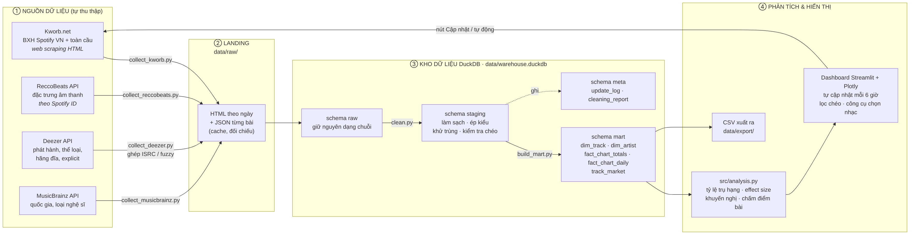

# Chọn nhạc cho thị trường Spotify Việt Nam: BXH Việt Nam vs Toàn cầu

Bài tập lớn môn Trực quan hóa dữ liệu. Pipeline **tự thu thập** dữ liệu từ 4 nguồn, làm sạch,
lưu trong kho **DuckDB** theo 3 tầng (raw → staging → mart), và một **dashboard Streamlit tự cập
nhật** giúp trả lời câu hỏi kinh doanh: *nên chọn / sản xuất bài hát như thế nào để lọt và trụ lâu
trên BXH Spotify Việt Nam, và khác thị trường toàn cầu ra sao?*

**Dashboard trực tuyến:** https://sr9mjlwiamzaoxsyuxp2hx.streamlit.app/  
**Mã nguồn:** https://github.com/zungz19/spotify-dashboard-

Chạy trên máy: `streamlit run app/dashboard.py` (Streamlit Cloud chạy `main.py`, file này gọi lại `app/dashboard.py`).



## Nguồn dữ liệu

| # | Nguồn | Cách lấy | Dùng để |
|---|---|---|---|
| 1 | Kworb.net (`vn_daily`, `vn_daily_totals`, `global_daily`, `global_daily_totals`) | Web scraping HTML | BXH ngày, số ngày trụ hạng, đỉnh, tổng stream |
| 2 | ReccoBeats API | REST, không cần key, tra theo Spotify ID | Đặc trưng âm thanh (danceability, energy, valence…), ISRC, thời lượng |
| 3 | Deezer API | REST, không cần key, ghép theo ISRC rồi fuzzy theo tên | Ngày phát hành, thể loại, hãng đĩa, explicit, BPM |
| 4 | MusicBrainz API | REST, 1 request/giây | Quốc gia nghệ sĩ, cá nhân/nhóm, giới tính |

> Từ 2/2026 Spotify Web API đã bỏ trường `popularity` và audio features, đồng thời bắt buộc tài khoản
> Premium, vì vậy dự án không gọi Spotify trực tiếp mà ghép các nguồn mở ở trên.

## Cấu trúc thư mục

```
config.py                 Cấu hình (thị trường, ngưỡng, giới hạn tốc độ gọi API...)
run_pipeline.py           Chạy pipeline từ dòng lệnh
src/
  http_client.py          Gọi HTTP: tự thử lại, giới hạn tốc độ, lưu landing
  collect_kworb.py        Nguồn 1 - scraping BXH
  collect_reccobeats.py   Nguồn 2 - đặc trưng âm thanh
  collect_deezer.py       Nguồn 3 - phát hành/thể loại/hãng đĩa (ghép ISRC + fuzzy)
  collect_musicbrainz.py  Nguồn 4 - quốc gia nghệ sĩ
  clean.py                Tầng staging: làm sạch + báo cáo làm sạch
  build_mart.py           Tầng mart: dim/fact + biến phái sinh + xuất CSV
  analysis.py             Phân tích dùng chung (tỷ lệ trụ hạng, effect size, khuyến nghị, chấm điểm)
  pipeline.py             Điều phối các bước + nhật ký meta.update_log
app/
  dashboard.py            Dashboard Streamlit
  charts.py               Hàm vẽ biểu đồ Plotly
data/
  raw/                    Landing: HTML/JSON gốc tải về (cũng là cache)
  warehouse.duckdb        Kho dữ liệu
  export/                 CSV của các bảng mart
docs/architecture.png     Sơ đồ kiến trúc
```

## Cách chạy

Yêu cầu Python 3.10 – 3.13.

```bash
python -m venv .venv
# Windows:  .venv\Scripts\activate      macOS/Linux:  source .venv/bin/activate
pip install -r requirements.txt

# 1) Thu thập + xử lý (lần đầu khoảng 1 giờ, phần lớn là chờ giới hạn tốc độ của API)
python run_pipeline.py

# 2) Mở dashboard
streamlit run app/dashboard.py
```

Lần chạy sau rất nhanh vì dữ liệu đã cache trong `data/raw/`: chỉ tải BXH mới và các bài mới lọt BXH.
Có thể chạy từng phần:

```bash
python run_pipeline.py --steps kworb clean mart   # chỉ lấy BXH hôm nay rồi dựng lại bảng
python run_pipeline.py --steps clean mart         # dựng lại staging/mart, không cần mạng
```

Nếu bị ngắt giữa chừng, chỉ cần chạy lại lệnh: các bài đã tải sẽ không tải lại.

## Tính "động" của dashboard

* Nút **🔄 Cập nhật dữ liệu ngay** chạy lại pipeline ngay trong dashboard và hiện tiến trình.
* **Tự động cập nhật**: cứ 30 phút dashboard kiểm tra; nếu dữ liệu cũ hơn 6 giờ thì tự lấy BXH mới.
* Mọi lần cập nhật đều ghi vào `meta.update_log` (tab *Dữ liệu & Pipeline*).
* **Lọc chéo**: bấm vào một cột trong biểu đồ tỷ lệ trụ hạng để xem danh sách bài của nhóm đó.
* **Công cụ chọn nhạc**: chọn một bài (hoặc tự nhập thông số) để chấm mức phù hợp với thị trường.

## Định nghĩa chính

* **Số ngày trụ hạng**: số ngày bài có mặt trong BXH Top 200 ngày của Spotify (cột *Days* trên Kworb).
* **Trụ lâu / Lướt qua**: số ngày thuộc top 25% / bottom 25% của từng thị trường.
* Bài **đang còn trên BXH** mà chưa đạt ngưỡng trụ lâu được tách riêng ("Đang trên BXH"), vì chưa biết
  kết cục cuối cùng (dữ liệu bị kiểm duyệt phải).
* Phạm vi so sánh: toàn bộ bài từng lọt BXH Việt Nam và 2.500 bài nhiều stream nhất BXH toàn cầu
  (`GLOBAL_ENRICH_LIMIT` trong `config.py`).
